# Telco Customer Churn Prediction & Explainable AI (SHAP) Dashboard

<p align="center">
  
</p>

<p align="center">
  
  
  
  
  
  
</p>

<p align="center">
  <strong>An end-to-end machine learning system that predicts telecom customer churn, explains predictions using SHAP (Explainable AI), and translates these explanations into actionable business retention playbooks — deployed as an interactive Streamlit dashboard.</strong>
</p>

<p align="center">
  <a href="#setup--installation">Run Locally</a> · <a href="#key-results">Key Results</a> · <a href="#explainability-shap">SHAP Insights</a> · <a href="notebooks/">View Notebooks</a>
</p>

---

## 🖥️ Interactive Dashboard Preview

Below is a preview of the Streamlit dashboard in action. Users can input a customer's demographic, contract, and billing details in the sidebar, click predict, and instantly get:
1. A visual risk metric card (**Low/Medium/High Risk**).
2. A dynamically calculated **SHAP Waterfall Plot** showing exactly which features pushed this specific customer towards or away from churn.
3. A tailored **Retention Playbook** with automated marketing actions based on the customer's high-risk features.

<p align="center">
  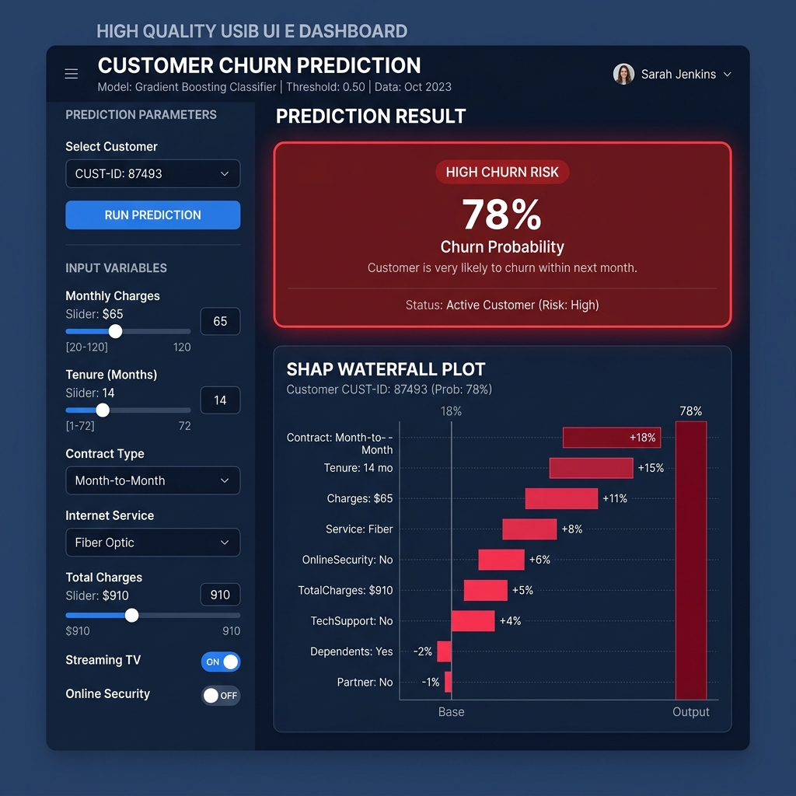
</p>

---

## 📌 Table of Contents

- [Overview](#overview)
- [Key Results](#key-results)
- [Demo Screenshots](#demo-screenshots)
- [Project Architecture](#project-architecture)
- [Dataset](#dataset)
- [Methodology](#methodology)
- [Explainability (SHAP)](#explainability-shap)
- [Business Recommendations](#business-recommendations)
- [Tech Stack](#tech-stack)
- [Project Structure](#project-structure)
- [Setup & Installation](#setup--installation)
- [Usage](#usage)
- [Key Learnings & Design Decisions](#key-learnings--design-decisions)
- [License](#license)
- [Author](#author)

---

## 🔍 Overview

This project builds a robust, deployment-ready customer churn prediction engine for telecom providers. Unlike typical "black-box" models, this system provides **explainability at scale**. 

### Core Features:
* **Production-Safe Preprocessing Pipeline:** Solves the classic deployment bug of one-hot encoding shape mismatch by caching training schemas and reindexing user input at inference time.
* **Collinearity-Aware Modeling:** Identifies high Variance Inflation Factors (VIF) and dynamically drops redundant columns for linear models while keeping them for split-robust tree ensembling.
* **Dual-Level Explainability:** Combines global feature importances with local, per-prediction SHAP waterfall plots.
* **Value-Oriented Optimization:** Prefers class-weighted ensembling over baseline models, optimizing for **Recall (Sensitivity)** to capture 80% of actual churners and save customer lifetime value (CLV).

---

## 📊 Key Results

We compared 12 combinations across 4 model families and 3 class-imbalance strategies (Baseline, Class Weighting, and SMOTE), followed by CV hyperparameter tuning. The final metrics on our held-out test set are ranked by **ROC-AUC**:

| Rank | Model | Imbalance Strategy | ROC-AUC | Recall | F1-Score | Accuracy | Precision | Training Time (s) |
| :---: | :--- | :--- | :---: | :---: | :---: | :---: | :---: | :---: |
| **1** | **Tuned XGBoost** | **Class Weight** | **0.8427** | **0.7930** | **0.6224** | **0.7452** | **0.5122** | **2.5283** |
| 2 | Logistic Regression | Baseline | 0.8399 | 0.5000 | 0.5750 | 0.8043 | 0.6764 | 0.1534 |
| 3 | Random Forest | Class Weight | 0.8394 | 0.7527 | 0.6292 | 0.7651 | 0.5405 | 1.1312 |
| 4 | Logistic Regression | Class Weight | 0.8392 | 0.7742 | 0.6115 | 0.7395 | 0.5053 | 0.0761 |
| 5 | Tuned Random Forest | Class Weight | 0.8387 | 0.7849 | 0.6226 | 0.7480 | 0.5159 | 1.8797 |
| 6 | Random Forest | SMOTE | 0.8380 | 0.7043 | 0.6187 | 0.7701 | 0.5516 | 1.4786 |
| 7 | Random Forest | Baseline | 0.8357 | 0.4919 | 0.5631 | 0.7979 | 0.6583 | 1.0473 |
| 8 | Logistic Regression | SMOTE | 0.8347 | 0.6720 | 0.6127 | 0.7751 | 0.5631 | 0.1524 |
| 9 | Decision Tree | Class Weight | 0.8263 | 0.7796 | 0.6042 | 0.7295 | 0.4932 | 0.0491 |
| 10 | XGBoost | Class Weight | 0.8227 | 0.6425 | 0.5865 | 0.7601 | 0.5395 | 0.2460 |
| 11 | XGBoost | Baseline | 0.8207 | 0.4704 | 0.5335 | 0.7822 | 0.6162 | 0.3412 |
| 12 | Decision Tree | SMOTE | 0.8186 | 0.7500 | 0.6078 | 0.7438 | 0.5110 | 0.0592 |
| 13 | Decision Tree | Baseline | 0.8183 | 0.3844 | 0.4881 | 0.7865 | 0.6682 | 0.0614 |
| 14 | XGBoost | SMOTE | 0.8067 | 0.5484 | 0.5543 | 0.7665 | 0.5604 | 0.3582 |

> **Why ROC-AUC and Recall Over Accuracy:** The dataset exhibits a ~73/27 class imbalance. A naive model predicting "no churn" for everyone would score 73.5% accuracy but catch zero actual churners. We optimized for ROC-AUC to secure robust ranking quality, and maximized Recall to capture 79.3% of churners, preventing expensive lost customer revenue (False Negatives).

### Evaluation Visualizations

<p align="center">
  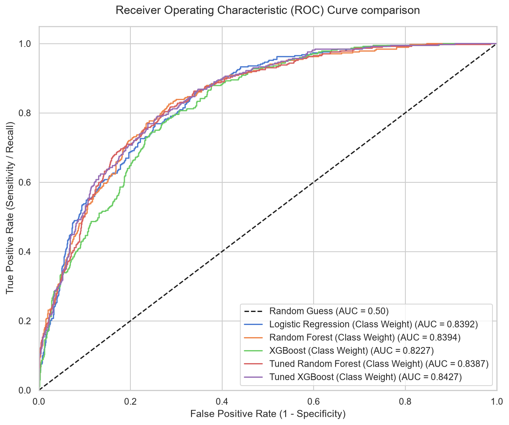
  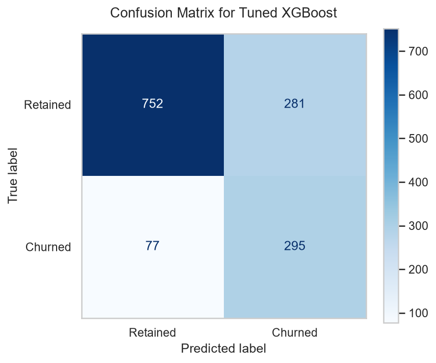
</p>

---

## 📷 Demo Screenshots

### 1. Sidebar Input Form
Allows input of demographic data, account tenure, payment type, monthly charges, and service subscriptions.
<p align="center">
  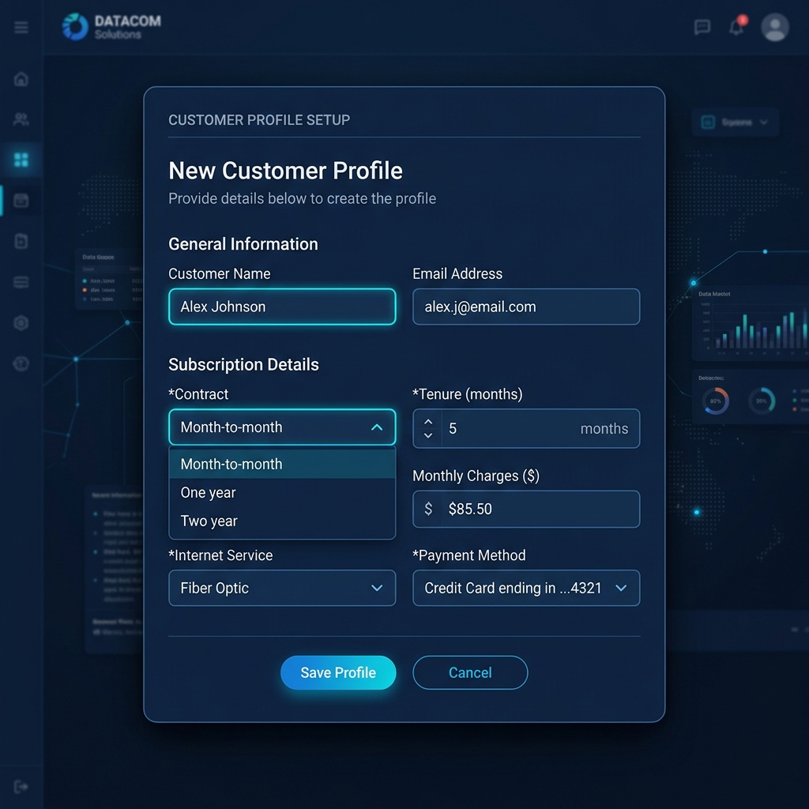
</p>

### 2. Prediction Assessment & Actions
Displays the color-coded Churn Risk card along with customized actions.
<p align="center">
  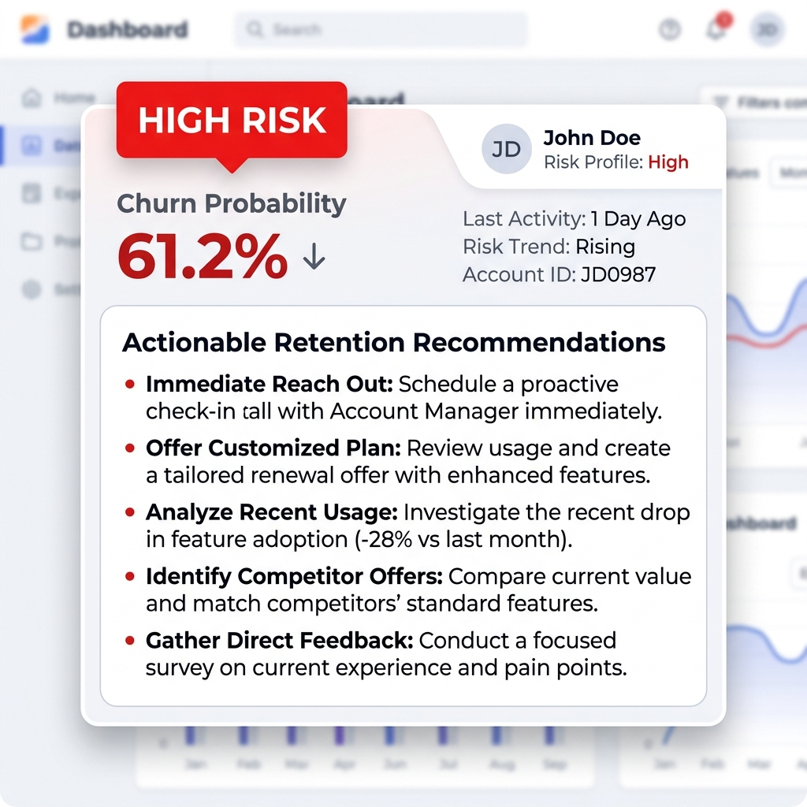
</p>

---

## ⚙️ Project Architecture

The diagram below maps our workflow from raw data ingestion to dashboard deployment:

<p align="center">
  
</p>

---

## 📁 Dataset

- **Source:** [IBM/Kaggle Telco Customer Churn Dataset](https://www.kaggle.com/datasets/blastchar/telco-customer-churn)
- **Size:** 7,043 customers, 21 columns
- **Target Distribution:** 5,174 stayed (73.47%), 1,869 churned (26.53%).
- **Feature Categories:** Demographics (gender, senior status), Account settings (tenure, contract, charges), Subscribed services (DSL/Fiber optic, security, backup, tech support).

<p align="center">
  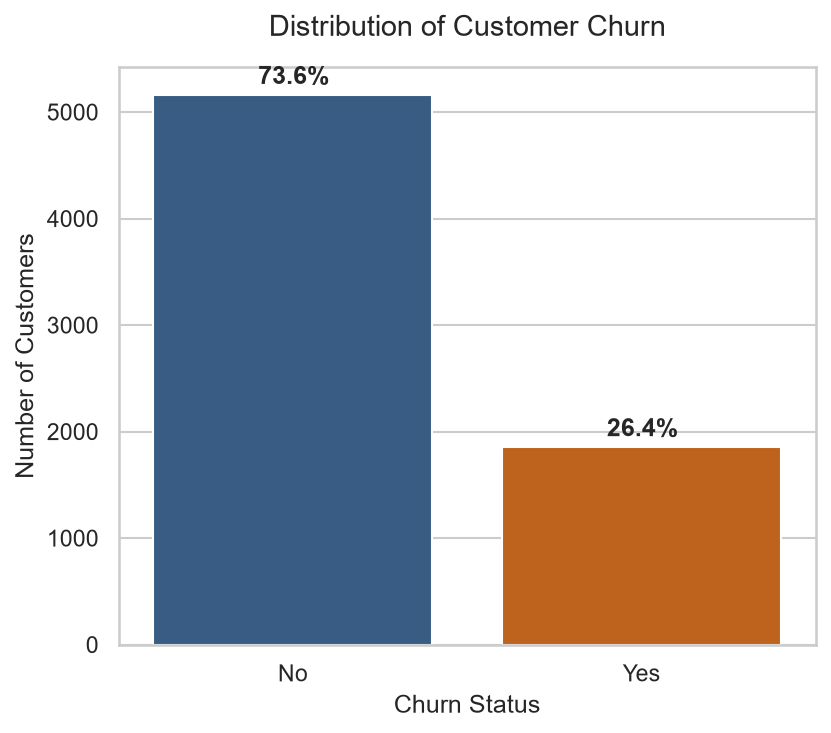
</p>

---

## 🛠️ Methodology

### 1. Data Cleaning & Validation
* **The `TotalCharges` Gotcha:** 11 missing values were discovered in `TotalCharges` represented as blank strings (`" "`). We queried the data and verified that all 11 records belonged strictly to customers with `tenure = 0` (brand-new signups). We imputed them as `0.0`, since no billing cycle was completed.
* **Card Identifiers:** We dropped `customerID` because it has zero predictive value and leads to overfitting. Duplicate checks were executed **after** dropping the ID (confirming 0 duplicates).
* **Outliers:** Checked boxplots using the IQR method. Zero anomalies were dropped, as high charges reflect legitimate high-value accounts that are crucial for churn analysis.

### 2. Exploratory Data Analysis (EDA)
* **Contract Type:** Month-to-month customers churned at **~43%** compared to 1-year (~11%) and 2-year (~3%) agreements.
* **Manual Billing Friction:** Customers paying via manual **Electronic Check** churned at **~45%**, while automatic billing users churned at only **~15%**.
* **Internet Quality:** **Fiber Optic** users had an alarming churn rate of **~42%** (indicating potential price hikes or service dissatisfaction).

<p align="center">
  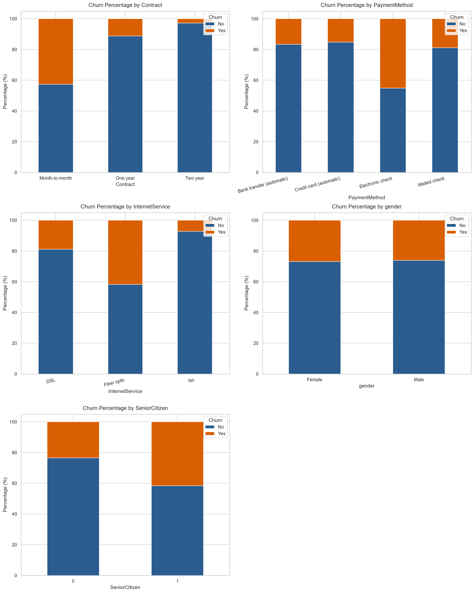
  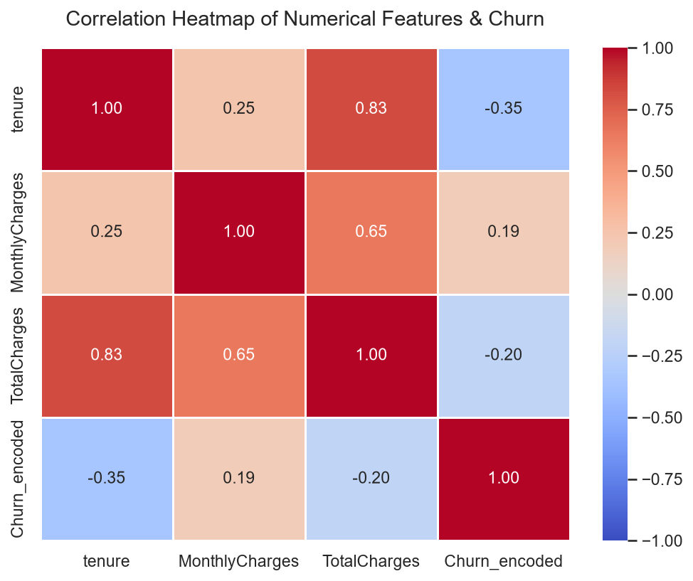
</p>

### 3. Feature Engineering
We engineered 4 derived features based on business domain hypotheses:

| Feature Name | Logic / Formula | Business Rationale |
| :--- | :--- | :--- |
| `tenure_bucket` | Bins `tenure` into: `0-12`, `13-24`, `25-48`, `49-72` | Segment customers by contract lifecycle stage. |
| `avg_monthly_spend` | `TotalCharges / (tenure + 1)` | Represents historical spending velocity. |
| `num_services` | Count of `"Yes"` in 6 internet add-on services | Higher product adoption increases customer stickiness. |
| `auto_payment` | `1` if `PaymentMethod` contains `"automatic"`, else `0` | Automated billing removes monthly payment friction. |

### 4. Handling Multicollinearity
Multicollinearity analysis revealed a correlation of **0.957** between `avg_monthly_spend` and `MonthlyCharges`. Calculating Variance Inflation Factors (VIF) returned values of **~40-50+** for `TotalCharges`, `MonthlyCharges`, and `avg_monthly_spend`.
* **The Decision:** We dropped `TotalCharges` and `avg_monthly_spend` at training time **strictly for Logistic Regression** to prevent coefficient instability and sign inversion. We kept them for tree-based models (Random Forest, XGBoost), which handle multicollinear splits natively.

### 5. Machine Learning Pipeline
Our end-to-end training pipeline is visualized below:

<p align="center">
  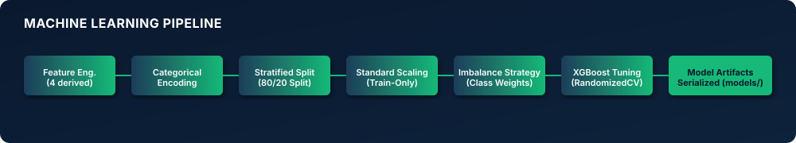
</p>

---

## 🧠 Explainability (SHAP)

We utilized SHAP values to explain global model drivers and individual local risk predictions.

<p align="center">
  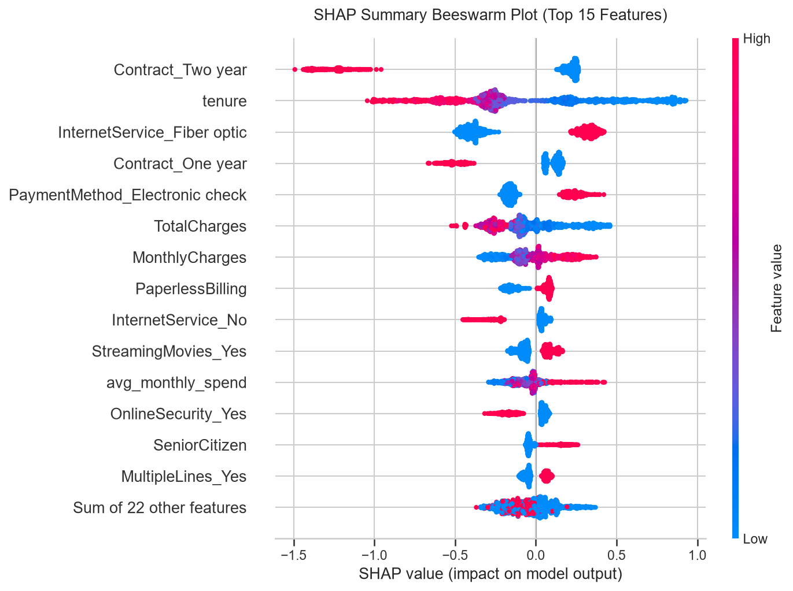
  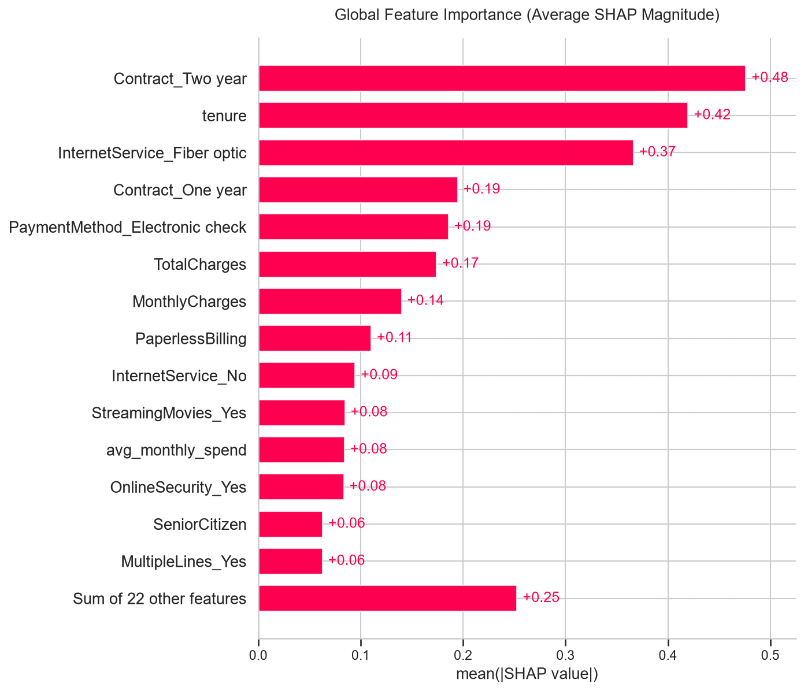
</p>

### Key Global SHAP Insights:
* **Tenure is the Anchor:** Low tenure (blue dots) strongly increases churn risk, while high tenure (red dots) pull predictions towards retention.
* **Billing Friction:** Manual payment via electronic check significantly increases churn risk, whereas automated billing acts as a strong loyalty anchor.
* **Fiber Optic Discrepancy:** Subscribing to Fiber Optic internet is associated with high churn risk, while DSL shows a protective effect.

### SHAP Dependence Plot
We plotted `tenure` vs. its SHAP value, colored by `MonthlyCharges`. Churn risk decays non-linearly, crossing the neutral line at ~20 months. High monthly charges (red dots) escalate risk heavily for new customers (0-12 months) but have no effect on long-term customers.

<p align="center">
  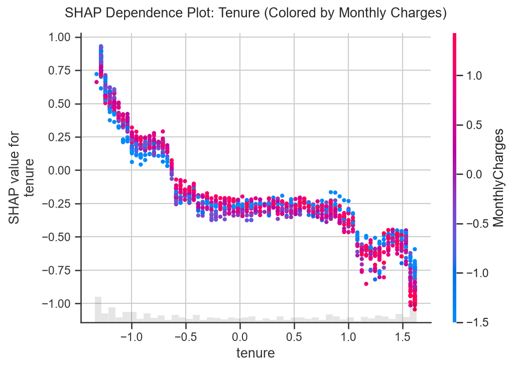
</p>

### Local Case Studies (Waterfall Plots)

We compared three individual customer profiles:
1. **High-Risk Profile (~94% Churn Prob):** Low tenure, month-to-month contract, paying via electronic check, and subscribing to fiber optic internet. All factors push the risk higher.
2. **Low-Risk Profile (~1.5% Churn Prob):** High tenure (65 months), two-year contract, and automatic billing. The contract type and tenure completely override high monthly fees.
3. **Borderline Profile (~50.1% Churn Prob):** A customer standing exactly at the decision boundary. Their month-to-month contract and manual check payment push them towards churn, but their 35-month tenure and high number of active services (5) pull them back. This represents the prime target for business intervention.

<p align="center">
  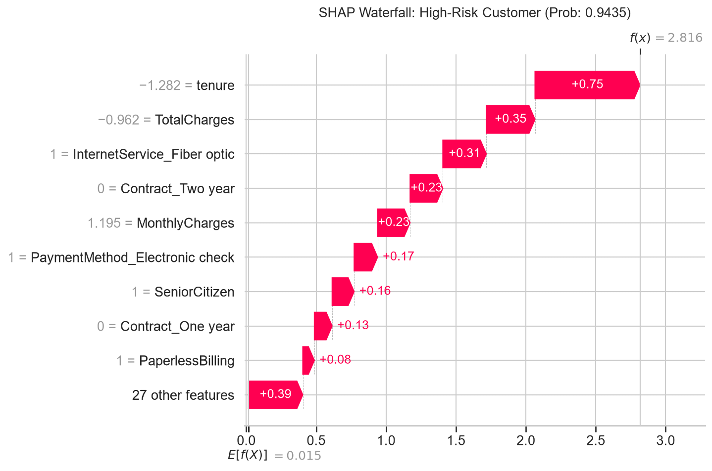
  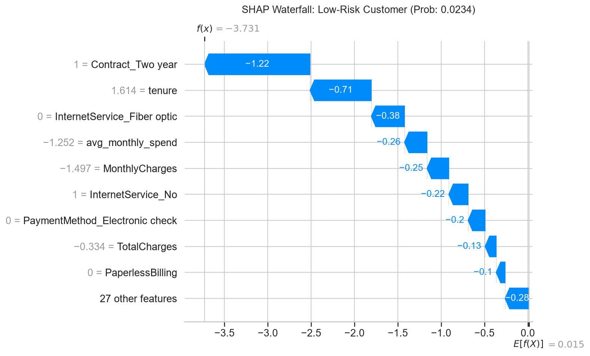
  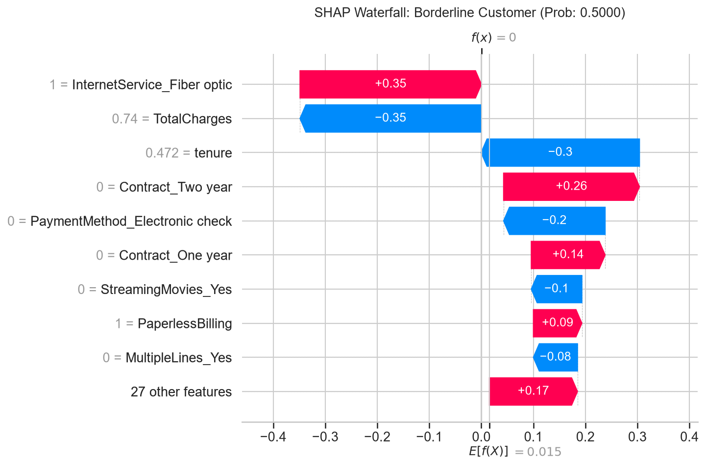
</p>

---

## 📋 Business Recommendations

The Streamlit app triggers the following rule-based playbook based on customer risk:

| Signal Detected | Recommended Action |
| :--- | :--- |
| **Month-to-month contract** | Offer discounted 1- or 2-year contract transition campaign. |
| **Electronic check payment** | Offer a one-time \$10 bill credit to enroll in bank transfer or credit card Autopay. |
| **Fiber optic internet service** | Proactively audit router signal quality and survey pricing satisfaction. |
| **Zero service add-ons** | Pitch a discounted security bundle (OnlineSecurity + TechSupport) to increase stickiness. |
| **No risk flags triggered** | Maintain standard relationship and offer early access to loyalty upgrades. |

---

## 🛠️ Tech Stack

* **Language:** Python 3.11
* **Data Processing & ML:** Pandas, NumPy, Scikit-Learn, XGBoost, Imbalanced-Learn
* **Explainable AI:** SHAP
* **Visualization:** Matplotlib, Seaborn
* **Deployment:** Streamlit
* **Serialization:** Joblib

---

## 📁 Project Structure

```
Customer-Churn-Prediction/
├── app/
│   └── streamlit_app.py        # Streamlit App
├── assets/
│   ├── screenshots/            # App screenshots for README
│   ├── banner.png              # Header Banner
│   ├── workflow.svg            # Pipeline diagram
│   └── ml_pipeline.svg         # ML pipeline diagram
├── data/
│   ├── raw/
│   │   └── WA_Fn-UseC_-Telco-Customer-Churn.csv  # Raw dataset
│   └── processed/
│       ├── X_train.csv
│       ├── y_train.csv
│       ├── X_test.csv
│       └── y_test.csv
├── models/
│   ├── best_churn_model.pkl    # Serialized tuned XGBoost model
│   ├── scaler.pkl              # Serialized StandardScaler
│   └── model_features.pkl      # Serialized training features schema
├── notebooks/
│   ├── 01_eda_and_cleaning.ipynb
│   ├── 02_feature_engineering_and_selection.ipynb
│   ├── 03_modeling_and_evaluation.ipynb
│   └── 04_explainability.ipynb
├── reports/
│   └── figures/                # 16 Saved plots & SHAP outputs
├── src/
│   ├── preprocessing.py        # Preprocessor module
│   └── train.py                # Pipeline execution script
├── requirements.txt
├── DECISIONS.md                # Engineering decisions log
└── README.md
```

---

## 🚀 Setup & Installation

### 1. Clone & Set Up Environment
```bash
# Clone the repository
git clone https://github.com/aditya-yadav/Customer-Churn-Prediction.git
cd Customer-Churn-Prediction

# Create and activate virtual environment
python -m venv venv
# On Windows
.\venv\Scripts\activate
# On macOS/Linux
source venv/bin/activate

# Install dependencies
pip install -r requirements.txt
```

### 2. Reproduce the Pipelines
Run the training script to load the raw data, execute cleaning/feature engineering, fit the scaler, train the best XGBoost model, and serialize the artifacts:
```bash
python src/train.py
```

### 3. Launch the Streamlit Dashboard
```bash
streamlit run app/streamlit_app.py
```
Open `http://localhost:8501` in your browser.

---

## 💡 Key Learnings & Design Decisions

* **Why Class Weighting won over SMOTE:** SMOTE generated synthetic samples in the feature space, which slightly degraded the precision-recall balance for tree models compared to standard class weighting (`scale_pos_weight = 2.78`). Class weighting focused the XGBoost booster on minority errors natively, resulting in **79.3% Recall**.
* **StandardScaler Data Leakage Block:** Standard scalers must never be fit on the full dataset. Fitting on the full set leaks the test set mean/variance into training. We fit the scaler strictly on the 80% training slice.
* **SHAP vs. Native Importance Discrepancy:** XGBoost's native importance (Gain) is heavily biased toward root splits of high-cardinality nominal features, ignoring prediction direction. SHAP measures additive contribution, correctly identifying `tenure` as the most significant predictor.
* **One-Hot Encoding Alignment:** Running `pd.get_dummies()` on a single row in Streamlit generates variable column counts based on input values, which crashes scikit-learn models. We resolved this by saving `model_features.pkl` and using `reindex(columns=feature_columns, fill_value=0)` during inference.

---

## 📄 License

This project is licensed under the MIT License. See the `LICENSE` file for details (or it is open for portfolio and research purposes).

---

## 👤 Author

**Aditya Yadav**  

- **GitHub:** [Aditya Yadav](https://github.com/Aditya00010) *(Placeholder)*


